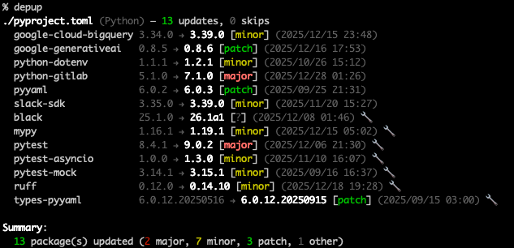
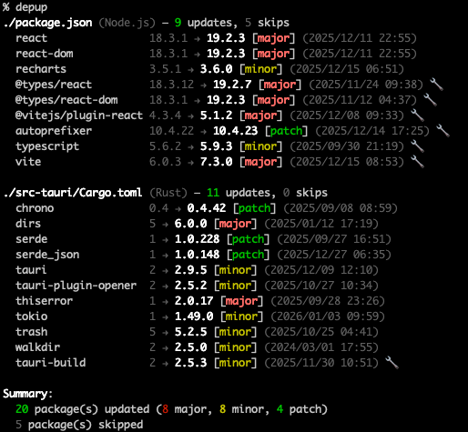

<p align="center">
  
</p>

<h1 align="center">depup</h1>

<p align="center">
  公開後の待機期間と OSV 照会を備え、サプライチェーン攻撃のリスクを抑えながら複数言語の依存関係を更新する CLI
</p>

<!-- standard:badges:start -->
<h3 align="center">対応プラットフォーム</h3>

<p align="center">
  
  
  
</p>

<p align="center">
  <a href="https://github.com/owayo/depup/actions/workflows/ci.yml"></a>
  <a href="https://github.com/owayo/depup/releases/latest"></a>
  <a href="LICENSE"></a>
</p>

<p align="center">
  <a href="README.md">English</a> |
  <a href="README.ja.md">日本語</a>
</p>
<!-- standard:badges:end -->

---

depup は、ふだんの依存関係更新で悪意のあるバージョンを取り込むリスクを減らします。デフォルトでは公開から 1 週間待ってから候補に加えるため、メンテナーやレジストリが問題を見つけて対処する時間を取れます。更新候補は OSV.dev に照会し、公表済みの脆弱性やマルウェアの報告を確認します。

Node.js や Python、Rust など、複数言語のマニフェストを 1 回で探し、バージョン指定を書き換えます。固定版はデフォルトで維持し、範囲指定の演算子や上限も保ちます。

`--install` を付けると、パッケージマネージャーを実行し、`Cargo.lock` と対応する npm・pnpm の lockfile で実際に解決された版を監査します。

## 機能

| 機能 | 動作 |
|---|---|
| 公開後の待機期間 | デフォルトは 1 週間。プロジェクトの age 設定を継承し、uv・mise の設定が厳しければそちらに従います。 |
| OSV の照会 | 候補の既知の脆弱性とマルウェア報告を確認。脆弱性が残る更新は、重大度と件数の条件に従って判定します。 |
| 取得元の確認 | Node.js と Composer の対応するプロジェクト設定を調べ、私設の依存を同名の公開パッケージで置き換えるリスクを減らします。 |
| lockfile の監査 | `--install` は pnpm・uv・mise に age を渡し、`Cargo.lock` と対応する npm・pnpm の lockfile で、直接依存と推移依存の版を確認します。この実行で加わった版が age 条件を満たせなければ、影響を受けるファイルを復元し、終了コード `2` を返します。 |
| 複数言語の更新 | 8 言語の依存と mise のツールを 1 回で更新します。`package.json` の Bun カタログにも対応します。 |
| Git サブモジュール | [`--submodules`](docs/ecosystems.ja.md#git-サブモジュール) で参照コミットの更新と事前確認が可能です。 |
| バージョン制約 | 固定版はデフォルトで維持します。範囲指定の演算子や、プレリリースとパッチの修飾子を含む上限、Cargo の `= 1.*` の形も保ちます。 |
| モノレポ | `.depup`、Cargo・pnpm・Go の workspace、Gradle のマルチプロジェクト、ネストした install、Tauri プロジェクトに対応します。 |
| 出力形式 | 公開日を色付きのテキストで表示し、JSON や diff でも出力できます。 |

### 対応言語

<p align="center">
  
  
  
  
  
  
  
  
  
</p>

| 言語 | マニフェスト | レジストリ | ロックファイル |
|------|-------------|----------|---------------|
|  Node.js | package.json（Bun catalogs を含む） | npm | package-lock.json、pnpm-lock.yaml、yarn.lock、bun.lock、bun.lockb |
|  Python | pyproject.toml | PyPI | uv.lock、requirements.lock、poetry.lock |
|  Rust | Cargo.toml | crates.io | Cargo.lock |
|  Go | go.mod（go.work のメンバーも自動検出） | Go Proxy | go.sum |
|  Ruby | Gemfile | RubyGems | Gemfile.lock |
|  PHP | composer.json | Packagist | composer.lock |
|  Java | build.gradle、build.gradle.kts、gradle/*.versions.toml（settings.gradle のサブプロジェクトも自動検出） | Maven Central | gradle.lockfile |
|  Swift | Package.swift | GitHub Tags | Package.resolved |
|  mise | mise.toml、.mise.toml、.config/mise/config.toml、.tool-versions など | `mise ls-remote` | mise.lock |

## 動作環境

- **mise**: 実行時には、mise のツールバージョンを更新する場合にのみ必要です（バージョン一覧を `mise ls-remote` から取得するため）。mise がない環境では mise の設定ファイルを読み飛ばし、警告を 1 回表示して他の言語の更新を続けます。
- **パッケージマネージャー**: `--install` は各プロジェクトのパッケージマネージャー（npm、pnpm、uv、Cargo、Bundler、Composer、Gradle など）を実行するため、それらが入っている必要があります。入っていないパッケージマネージャーは install の失敗として扱います。
- **ネットワーク接続**: バージョンは公開レジストリから取得し、脆弱性チェックでは OSV.dev の API に問い合わせます。

## インストール

<!-- standard:install:start -->
### Homebrew (macOS/Linux)

```bash
brew install owayo/depup/depup
```

### winget (Windows)

```powershell
winget install owayo.depup
```

### Cargo

Rust 1.99 以上が必要です。

```bash
cargo install --git https://github.com/owayo/depup --locked
```

### GitHub Releases から

[Releases](https://github.com/owayo/depup/releases/latest) から自分の環境のアーカイブを取得して展開し、`depup` を `PATH` の通った場所に置きます。各リリースには、取得したファイルを確かめるための `SHA256SUMS` も添付しています。

| プラットフォーム | ファイル |
|---|---|
| Linux (x86_64) | `depup-x86_64-unknown-linux-gnu.tar.gz` |
| Linux (ARM64) | `depup-aarch64-unknown-linux-gnu.tar.gz` |
| macOS (Intel) | `depup-x86_64-apple-darwin.tar.gz` |
| macOS (Apple Silicon) | `depup-aarch64-apple-darwin.tar.gz` |
| Windows (x86_64) | `depup-x86_64-pc-windows-msvc.zip` |

macOS でブラウザから取得した場合は、実行の前に隔離属性を外します: `xattr -d com.apple.quarantine depup`。

### ソースから

[mise](https://mise.jdx.dev/) が必要です (Rust のツールチェーンは `mise.toml` で固定しています)。

```bash
git clone https://github.com/owayo/depup.git
cd depup
make install
```

`make install` は `/usr/local/bin` に入れます。場所を変えるときは `INSTALL_PATH` を指定します (例: `make install INSTALL_PATH="$HOME/.local/bin"`)。
<!-- standard:install:end -->

winget でインストールした直後は、PATH の変更を反映させるためにターミナルを開き直してください。ソースから入れたものを取り除くときは、同じ `INSTALL_PATH` を付けて `make uninstall` を実行します。

## 使い方

```bash
depup [OPTIONS] [PATH]
```

`PATH` には処理するディレクトリを指定します（省略時はカレントディレクトリ）。`--node` や `--python` のような言語のオプションで絞らない限り、そこで見つかった対応言語をすべて更新します。

```bash
# すべての更新内容をプレビュー（ドライラン）
depup -n

# Node.js の依存関係のみ更新
depup --node

# lodash と typescript のみ更新
depup --only lodash --only typescript

# react を更新対象から除外
depup --exclude react

# 公開から 2 週間以上経過したバージョンにのみ更新（デフォルトは 1 週間）
depup --age 2w

# diff を表示して更新
depup --diff

# 更新後に npm install などを実行
depup --node --install

# CI/CD 向けに JSON で出力
depup --json
```

Python のプロジェクトと Tauri のプロジェクトでの出力例です。

<table>
  <tr>
    <td align="center">
      <strong>Python (pyproject.toml)</strong><br>
      
    </td>
    <td align="center">
      <strong>Tauri (package.json + Cargo.toml)</strong><br>
      
    </td>
  </tr>
</table>

### サプライチェーン攻撃への対策

待機期間に 2 週間を指定して更新をプレビューします。OSV に既知の脆弱性がある版は候補から外します。

```bash
depup --dry-run --age 2w --osv --no-osv-risk-tradeoff
```

更新を適用する前に、OSV の照会失敗が警告に出ていないか確認してください。[サプライチェーン攻撃への対策](docs/usage.ja.md#サプライチェーン攻撃への対策)で、取得元や推移依存、lockfile の検証範囲を説明します。

### 更新の基本ルール

depup は、固定されていない依存について公開済みのバージョンを調べ、以下の条件を満たす最新のものを選んでマニフェストを書き換えます。デフォルトの条件は次のとおりです。

- `package.json` の `"1.2.3"` のようにバージョンを 1 つに決めた指定は、意図的な固定（固定指定）とみなし、`--include-pinned` を付けない限り更新しません。Go と mise は例外です（[固定指定と `--include-pinned`](docs/usage.ja.md#固定指定と---include-pinned)）。
- 公開から 1 週間以上経過したバージョンだけを候補にします（[age フィルター](docs/usage.ja.md#age-フィルター)）。
- 既知の脆弱性がない版を優先します。既存の脆弱性を修正できる更新は、新しい Medium／Low が加わる場合も条件付きで許可します（[脆弱性チェック](docs/usage.ja.md#脆弱性チェックosvdev)）。
- 現在のバージョンが安定版なら、プレリリースは提案しません（[候補のバージョン順序とプレリリース](docs/usage.ja.md#候補のバージョン順序とプレリリース)）。
- 範囲指定は形と上限を保ち、下限だけを進めます（[範囲の上限と下限](docs/usage.ja.md#範囲の上限と下限)）。
- メジャーバージョンを上げる更新も許可します。制限するには `--max-change` を使います（[更新幅の制限](docs/usage.ja.md#更新幅の制限--max-change)）。

### 脆弱性が残る更新の許可条件（デフォルトで有効）

既存の脆弱性を修正できる場合は、新しい Medium／Low が加わる更新も、以下の条件で許可します。新たに加わる脆弱性1件ごとに、同じかそれ以上の重大度の脆弱性を1件修正する必要があります。

| 修正する脆弱性 | 新たに加わる脆弱性 | 更新の可否 |
|---|---|---|
| Critical または High 1件 | Medium または Low 1件 | 警告付きで許可 |
| Medium 1件 | Medium または Low 1件 | 警告付きで許可 |
| Low 1件 | Low 1件 | 警告付きで許可 |
| Low 1件 | Medium・High・Critical のいずれか1件 | 不許可 |
| Critical 1件 | Medium 2件 | 修正件数を超えるため不許可 |

新しい High・Critical・重大度不明の脆弱性が加わる更新は許可しません。マルウェアが残る更新も対象外です。同じ重大度の脆弱性が新たに加わることも認めるため、実際のリスクが必ず下がるという意味ではありません。

件数はパッケージごとに数え、同じ脆弱性を指す別名の ID は重複を除きます。同じ lockfile の別バージョンに脆弱性が残る場合は、修正した件数に含めません。

候補は「既知の脆弱性がない版」「新しい脆弱性を増やさず、一部を修正する版」「上の許可条件を満たす版」の順に探します。**age の待機期間と他の更新条件は引き続き適用します。** 比較には確認できた lockfile の版（Cargo、対応する npm／pnpm の lockfile）、または Python／Ruby／PHP の固定バージョン指定を使います。現在版が不明な場合や、マニフェストの範囲指定の下限しか分からない場合は、脆弱性が残る更新を許可しません。

これらの条件で許可した更新には、修正した脆弱性・新たに加わる脆弱性・更新前から残る脆弱性をテキストと JSON で表示します。既知の脆弱性が残るため、`✓ OSV` マークは付きません。既知の脆弱性がある候補をすべて除外するには、`--no-osv-risk-tradeoff` を付けるか、グローバル設定で `osv_risk_tradeoff = false` を指定します。`--no-osv` はチェック自体を無効にします。

### 詳しいドキュメント

- [更新候補の絞り込み](docs/usage.ja.md#更新候補の絞り込み): age フィルター、プロジェクトの age 設定、OSV.dev の脆弱性チェック、`--max-change`
- [バージョン指定と書き換え](docs/usage.ja.md#バージョン指定と書き換え): どの指定を固定とみなすか、範囲と書式をどう保つか、どの制約を書き換えないか
- [パッケージマネージャーの実行](docs/usage.ja.md#パッケージマネージャーの実行--install): `--install` がパッケージマネージャーごとに実行するコマンドと、推移的依存に age フィルターがどこまで効くか
- [更新されないとき](docs/usage.ja.md#更新されないとき): `--verbose` で表示されるスキップの理由
- [コマンドラインリファレンス](docs/cli-reference.ja.md): すべてのオプション、テキスト・JSON・diff の出力、終了コード
- [エコシステムとモノレポ](docs/ecosystems.ja.md): ワークスペースと Tauri プロジェクトの扱い、エコシステムごとに depup が読み取る宣言

## 設定

depup のデフォルト、モノレポのディレクトリ、公開期間の制約は次の設定から読み取ります。コマンドラインのオプションは、depup のグローバル設定のデフォルトより優先されます。明示されたプロジェクトの age は `--age` より優先し、uv・mise 自身の厳しい制約も維持します。

| 設定 | 置き場所 | 用途 |
|---|---|---|
| グローバル設定 | `~/.config/depup/config.toml`（初回実行時に作成） | 共通する `age`・`osv`・`osv_risk_tradeoff`・`max_change` のデフォルトと、確認済み公開者の例外（`age_exempt`） |
| モノレポのディレクトリ | プロジェクトのルートの `.depup` | 追加で処理するディレクトリ |
| プロジェクトの age 設定 | pnpm・Bun の設定の `minimumReleaseAge`、mise の設定の `minimum_release_age` | そのプロジェクトの最小公開期間 |
| PM 自身の age 制約 | uv の `exclude-newer`、mise のグローバル・ローカル・ツール単位の age | 候補選択と install で厳しい cutoff を維持 |

各マニフェストは祖先ディレクトリの age を継承します。install や Cargo ワークスペースの lock を共有する場合は、更新がないメンバーも含めて最も厳しい設定を使います。読み取り元、優先順位、制限は [age フィルター](docs/usage.ja.md#age-フィルター)を参照してください。

たとえば、どのプロジェクトでも 1 週間ではなく 2 週間待ち、メジャーバージョンを上げる更新をしないようにするには、次のように書きます。

```toml
# ~/.config/depup/config.toml
age = "2w"
max_change = "minor"
```

すべてのキー、`.depup` の書式、不正な値の扱いは [docs/configuration.ja.md](docs/configuration.ja.md) にまとめています。

## 開発

<!-- standard:dev:start -->
[mise](https://mise.jdx.dev/) が必要です。ツールの版は `mise.toml` で固定しています。

```bash
make setup   # ツールチェーン (mise) と依存を取得する
make ci      # CI と同じ検査 (書き換えない)
```

| コマンド | 説明 |
|---|---|
| `make setup` | ツールチェーン (mise) と依存を取得する |
| `make build` | デバッグ版をビルドする |
| `make release` | リリース版をビルドする |
| `make run` | デバッグ版を実行する (引数は ARGS="...") |
| `make test` | テストを実行する |
| `make lint` | clippy を警告ゼロで通す |
| `make fmt` | コードを整形する (書き換える) |
| `make fmt-check` | 整形済みかを確かめる (書き換えない) |
| `make check` | 整形と静的検査 (書き換えない) |
| `make ci` | CI と同じ検査 (書き換えない) |
| `make install` | リリース版を INSTALL_PATH (既定 /usr/local/bin) に入れる |
| `make uninstall` | INSTALL_PATH から取り除く |
| `make clean` | ビルド成果物を消す |

`make` でターゲットの一覧を表示します。リリースは GitHub Actions で行います (**Actions → Release → Run workflow**)。
<!-- standard:dev:end -->

追加のテスト用ターゲット、JSON・Cargo マニフェストの性能計測、CI が OS ごとに実行する内容、リリースの手順は [docs/development.ja.md](docs/development.ja.md) で説明しています。Windows では `make` のターゲットを Git Bash で実行します。PowerShell で同じ検査を行うコマンドも同文書に記載しています。

## ライセンス

<!-- standard:license:start -->
[MIT](LICENSE)
<!-- standard:license:end -->
