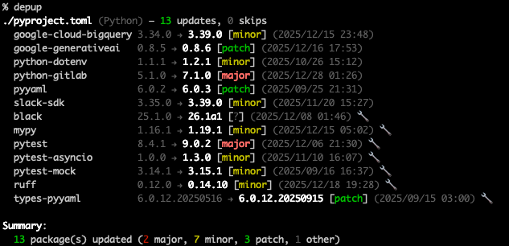
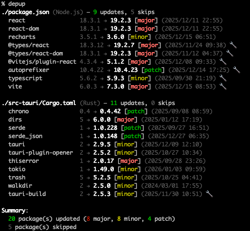

<p align="center">
  
</p>

<h1 align="center">depup</h1>

<p align="center">
  Multi-language dependency updater CLI with release cooldowns and OSV checks to reduce software supply chain risk
</p>

<!-- standard:badges:start -->
<h3 align="center">Supported Platforms</h3>

<p align="center">
  
  
  
</p>

<p align="center">
  <a href="https://github.com/owayo/depup/actions/workflows/ci.yml"></a>
  <a href="https://github.com/owayo/depup/releases/latest"></a>
  <a href="LICENSE"></a>
</p>

<p align="center">
  <a href="README.md">English</a> |
  <a href="README.ja.md">日本語</a>
</p>
<!-- standard:badges:end -->

---

depup helps keep compromised releases out of routine dependency updates. The default one-week cooldown gives maintainers and registries time to flag a malicious release. depup checks update candidates against published vulnerability and malware reports on OSV.dev.

One run finds and updates manifests for Node.js, Python, Rust, Go, Ruby, PHP, Java, Swift, and mise. By default, depup keeps intentional pins. It preserves range operators and upper bounds when rewriting constraints.

Add `--install` to run each project's package manager and audit the resolved versions in `Cargo.lock` and supported npm and pnpm lockfiles.

## Features

| Feature | What depup does |
|---|---|
| Release cooldown | Uses a one-week wait by default. Inherits project age settings and honors stricter native uv and mise cutoffs. |
| OSV advisories | Checks candidates for reported vulnerabilities and malware. Severity and count limits govern when an update may leave a known vulnerability. |
| Registry sources | Checks supported Node.js and Composer project settings to avoid replacing private dependencies with same-named public packages. |
| Lockfile audits | `--install` passes the age policy to pnpm, uv, and mise and checks direct and transitive versions in `Cargo.lock` and supported npm and pnpm lockfiles. If a newly added version still violates the age policy, depup restores the affected files and returns exit code `2`. |
| Multi-language updates | Rewrites declarations for eight languages and mise tools in one run, including Bun catalogs in `package.json`. |
| Git submodules | Previews or advances submodule pointers with [`--submodules`](docs/ecosystems.md#git-submodules). |
| Version constraints | Keeps intentional pins by default. Preserves range operators and upper bounds, including prerelease and patch qualifiers, and Cargo wildcard notation such as `= 1.*`. |
| Monorepos | Supports `.depup`, Cargo, pnpm and Go workspaces, Gradle multi-project builds, nested installs, and Tauri projects. |
| Output formats | Shows release dates in colored text and supports JSON and diffs. |

### Supported Languages

<p align="center">
  
  
  
  
  
  
  
  
  
</p>

| Language | Manifest | Registry | Lock Files |
|----------|----------|----------|------------|
|  Node.js | package.json (including Bun catalogs) | npm | package-lock.json, pnpm-lock.yaml, yarn.lock, bun.lock, bun.lockb |
|  Python | pyproject.toml | PyPI | uv.lock, requirements.lock, poetry.lock |
|  Rust | Cargo.toml | crates.io | Cargo.lock |
|  Go | go.mod (go.work members auto-detected) | Go Proxy | go.sum |
|  Ruby | Gemfile | RubyGems | Gemfile.lock |
|  PHP | composer.json | Packagist | composer.lock |
|  Java | build.gradle, build.gradle.kts, gradle/*.versions.toml (settings.gradle subprojects auto-detected) | Maven Central | gradle.lockfile |
|  Swift | Package.swift | GitHub Tags | Package.resolved |
|  mise | mise.toml, .mise.toml, .config/mise/config.toml, .tool-versions, etc. | `mise ls-remote` | mise.lock |

## Requirements

- **mise**: At runtime, only needed to update mise tool versions (version lists come from `mise ls-remote`). Without it, depup ignores mise config files, warns once, and continues with the other languages
- **Package managers**: `--install` runs the package manager of each project (npm, pnpm, uv, Cargo, Bundler, Composer, Gradle, and so on), so it must be installed; a package manager that is not installed counts as a failed install
- **Network access**: Versions are looked up in the public registries, and the vulnerability check queries the OSV.dev API

## Installation

<!-- standard:install:start -->
### Homebrew (macOS/Linux)

```bash
brew install owayo/depup/depup
```

### winget (Windows)

```powershell
winget install owayo.depup
```

### Cargo

Requires Rust 1.99 or later.

```bash
cargo install --git https://github.com/owayo/depup --locked
```

### From GitHub Releases

Download the archive for your platform from [Releases](https://github.com/owayo/depup/releases/latest), extract it, and put `depup` on your `PATH`. Each release also includes `SHA256SUMS` for checking the downloads.

| Platform | Archive |
|---|---|
| Linux (x86_64) | `depup-x86_64-unknown-linux-gnu.tar.gz` |
| Linux (ARM64) | `depup-aarch64-unknown-linux-gnu.tar.gz` |
| macOS (Intel) | `depup-x86_64-apple-darwin.tar.gz` |
| macOS (Apple Silicon) | `depup-aarch64-apple-darwin.tar.gz` |
| Windows (x86_64) | `depup-x86_64-pc-windows-msvc.zip` |

On macOS, if you downloaded the archive with a browser, remove the quarantine attribute before running it: `xattr -d com.apple.quarantine depup`.

### From Source

Requires [mise](https://mise.jdx.dev/) (the Rust toolchain is pinned in `mise.toml`).

```bash
git clone https://github.com/owayo/depup.git
cd depup
make install
```

`make install` installs to `/usr/local/bin`. Set `INSTALL_PATH` to change it (for example `make install INSTALL_PATH="$HOME/.local/bin"`).
<!-- standard:install:end -->

After a winget install, open a new terminal so that the updated `PATH` takes effect. To remove a build installed from source, run `make uninstall` with the same `INSTALL_PATH`.

## Usage

```bash
depup [OPTIONS] [PATH]
```

`PATH` is the directory to process (defaults to the current directory). depup updates every supported language it finds there unless you limit it with a language flag such as `--node` or `--python`.

```bash
# Preview all updates (dry run)
depup -n

# Update Node.js dependencies only
depup --node

# Update only lodash and typescript
depup --only lodash --only typescript

# Exclude react from updates
depup --exclude react

# Only update to versions at least 2 weeks old (the default is 1 week)
depup --age 2w

# Update and show diff
depup --diff

# Update, then run the package manager install (npm install, etc.)
depup --node --install

# JSON output for CI/CD
depup --json
```

Output for a Python project and for a Tauri project:

<table>
  <tr>
    <td align="center">
      <strong>Python (pyproject.toml)</strong><br>
      
    </td>
    <td align="center">
      <strong>Tauri (package.json + Cargo.toml)</strong><br>
      
    </td>
  </tr>
</table>

### Supply Chain Security

Preview updates with a requested two-week cooldown and reject candidates that OSV reports as vulnerable.

```bash
depup --dry-run --age 2w --osv --no-osv-risk-tradeoff
```

Review any OSV lookup warnings before applying updates. The [supply chain security guide](docs/usage.md#supply-chain-security) covers registry sources, transitive dependencies, and lockfile verification.

### How depup Decides Updates

Unless a dependency is pinned, depup looks up its published versions, picks the newest one that passes the checks below, and rewrites the manifest in place. By default:

- An exact version such as `"1.2.3"` in `package.json` is treated as an intentional pin and is not updated unless you pass `--include-pinned`. Go modules and mise tools are exceptions ([Pinned Versions and `--include-pinned`](docs/usage.md#pinned-versions-and---include-pinned)).
- Only versions that have been public for at least one week are candidates ([Age Filter](docs/usage.md#age-filter)).
- Versions without known vulnerabilities are preferred. By default, updates that fix existing vulnerabilities may introduce new Medium/Low vulnerabilities within severity and count limits ([Vulnerability Check](docs/usage.md#vulnerability-check-osvdev)).
- Prereleases are not proposed while the current version is stable ([Candidate Ordering and Prereleases](docs/usage.md#candidate-ordering-and-prereleases)).
- Ranges keep their shape and upper bound; only the lower bound moves ([Upper and Lower Bounds of Ranges](docs/usage.md#upper-and-lower-bounds-of-ranges)).
- Major bumps are allowed unless `--max-change` caps them ([Limiting Bumps](docs/usage.md#limiting-bumps---max-change)).

### Allowing Updates with Remaining Vulnerabilities (Enabled by Default)

An update that fixes existing vulnerabilities may be allowed even if it introduces new Medium/Low vulnerabilities. Each new vulnerability requires a separate fix of the same or higher known severity.

| Vulnerabilities fixed | Newly introduced vulnerabilities | Update allowed? |
|---|---|---|
| 1 Critical or High | 1 Medium or Low | Yes, with a warning |
| 1 Medium | 1 Medium or Low | Yes, with a warning |
| 1 Low | 1 Low | Yes, with a warning |
| 1 Low | 1 Medium, High, or Critical | No |
| 1 Critical | 2 Medium | No: new vulnerabilities outnumber fixes |

Updates introducing High, Critical, or unknown-severity vulnerabilities are not allowed by this exception. Updates containing malware are also excluded. Allowing a new vulnerability of the same severity does not guarantee that real-world risk has decreased.

Counts are per package. Aliases for the same vulnerability are counted once; a vulnerability still present in another locked version does not count as fixed.

depup prefers versions without known vulnerabilities, then versions that fix some vulnerabilities without adding any, and finally versions meeting the conditions above. **The age waiting period and other update filters still apply.** The comparison requires confirmed Cargo or supported npm/pnpm lockfile versions, or a fixed Python/Ruby/PHP declaration. An unknown current version or a manifest range's lower bound alone does not qualify.

Updates allowed under these conditions report fixed vulnerabilities, new vulnerabilities, and existing vulnerabilities that remain in text and JSON. They do not receive the `✓ OSV` mark because known vulnerabilities remain. Use `--no-osv-risk-tradeoff`, or set `osv_risk_tradeoff = false` in the global configuration, to reject all candidates with known vulnerabilities. `--no-osv` disables the check entirely.

### More Documentation

- [Filtering Candidates](docs/usage.md#filtering-candidates): the age filter, project age policies, the OSV.dev check, and `--max-change`
- [Version Specifiers and Rewriting](docs/usage.md#version-specifiers-and-rewriting): which specifiers count as pinned, how ranges and formats are preserved, and which constraints are left unchanged
- [Running the Package Manager](docs/usage.md#running-the-package-manager---install): the command `--install` runs for each package manager, and how far the age filter reaches into transitive dependencies
- [When a Dependency Is Not Updated](docs/usage.md#when-a-dependency-is-not-updated): the skip reasons that `--verbose` lists
- [Command-Line Reference](docs/cli-reference.md): all options, the text / JSON / diff output, and the exit codes
- [Ecosystems and Monorepos](docs/ecosystems.md): workspaces and Tauri projects, and the exact declarations depup reads in each ecosystem

## Configuration

depup reads its defaults, monorepo directories, and release-age policies from the sources below. A command-line flag overrides depup's global defaults for that run. Explicit project age policies take precedence over `--age`; stricter uv and mise native constraints are also preserved.

| Setting | Location | Purpose |
|---|---|---|
| Global defaults | `~/.config/depup/config.toml`, created on the first run | Default `age`, `osv`, `osv_risk_tradeoff`, and `max_change`, plus verified publisher exceptions (`age_exempt`) |
| Monorepo directories | `.depup` at the project root | Additional directories to process |
| Project age policy | `minimumReleaseAge` in the pnpm or Bun settings, `minimum_release_age` in the mise settings | Minimum release age of that project |
| Native age constraints | uv's `exclude-newer` and mise's global, local, and per-tool age settings | Preserve stricter cutoffs during candidate selection and install |

Each manifest inherits age settings from its ancestors. Shared installs and Cargo workspace locks use the strictest applicable member policy, including members with no updates. See [Age Filter](docs/usage.md#age-filter) for sources, precedence, and limits.

For example, to wait two weeks instead of one and to rule out major bumps in every project:

```toml
# ~/.config/depup/config.toml
age = "2w"
max_change = "minor"
```

All keys, the `.depup` format, and how invalid values are handled: [docs/configuration.md](docs/configuration.md)

## Development

<!-- standard:dev:start -->
Requires [mise](https://mise.jdx.dev/). Tool versions are pinned in `mise.toml`.

```bash
make setup   # Install the toolchain (mise) and dependencies
make ci      # Run the same checks as CI (no changes)
```

| Command | Description |
|---|---|
| `make setup` | Install the toolchain (mise) and dependencies |
| `make build` | Build a debug binary |
| `make release` | Build a release binary |
| `make run` | Run the debug binary (arguments via ARGS="...") |
| `make test` | Run the tests |
| `make lint` | Run clippy with warnings as errors |
| `make fmt` | Format the code (rewrites files) |
| `make fmt-check` | Check the formatting (no changes) |
| `make check` | Run fmt-check and lint (no changes) |
| `make ci` | Run the same checks as CI (no changes) |
| `make install` | Install the release binary to INSTALL_PATH (default /usr/local/bin) |
| `make uninstall` | Remove the binary from INSTALL_PATH |
| `make clean` | Remove build artifacts |

Run `make` to list every target. Releases are published from GitHub Actions (**Actions → Release → Run workflow**).
<!-- standard:dev:end -->

The additional test targets, JSON and Cargo manifest benchmarks, what CI runs on each OS, and the release steps are described in [docs/development.md](docs/development.md). On Windows, run the `make` targets in Git Bash; the guide also lists equivalent PowerShell commands.

## License

<!-- standard:license:start -->
[MIT](LICENSE)
<!-- standard:license:end -->
